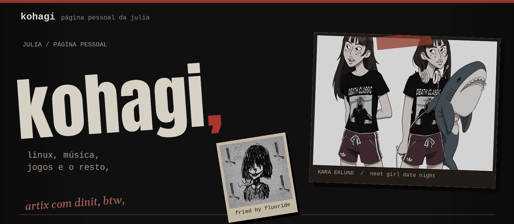
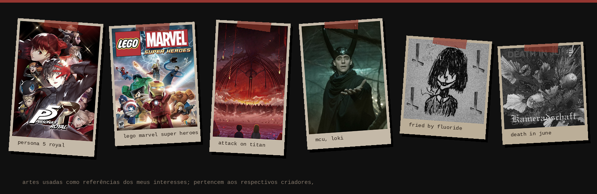

<div align="center">



<br>

[sobre](#sobre) · [setup](#setup) · [projetos](#projetos) · [o que eu mexo](#o-que-eu-mexo) · [interesses](#interesses) · [contato](#contato) · [sobre este site](#sobre-este-site)

</div>

<br>

## sobre

oi, eu sou a **julia**, na internet uso o nick **kohagi**,

estudo infraestrutura de informática e gosto de linux, hardware e projetos open-source,

também jogo, ouço música, vejo filmes e alguns animes, e gosto de conversar com meus amigos,

> *artix com dinit, btw,*

<br>

## setup

|  |  |
| :-- | :-- |
| **sistema** | artix linux |
| **init** | dinit |
| **desktop** | mangowm (wayland) |
| **dotfiles** | [victoria-mangowm-dotfiles](https://github.com/kohagizpk/victoria-mangowm-dotfiles) |

<br>

## projetos

**[victoria-mangowm-dotfiles](https://github.com/kohagizpk/victoria-mangowm-dotfiles)**
meu setup inteiro: um desktop wayland com cores tiradas do wallpaper, central de controle e instalador guiado,

**[portfolio](https://github.com/kohagizpk/portfolio)**
esta página pessoal, feita em html, css e js puros, no estilo colagem / recorte, [mais detalhes abaixo](#sobre-este-site),

<br>

## o que eu mexo


| área | o que eu faço |
| :-- | :-- |
| **linux** | uso no dia a dia, com artix, dinit e wayland, configuro tudo em dotfiles e automatizo com shell script |
| **servidores e redes** | estudando, com servidor caseiro rodando em docker |
| **hardware e suporte** | diagnóstico e manutenção de máquinas, troubleshooting de windows e linux, pendrive bootável com ferramentas |
| **eletrônica** | começando com arduino e esp32 |

<br>

## interesses

<div align="center">



</div>

<table>
<tr>
<td valign="top" width="33%">

**jogos**

› roblox<br>
› league of legends<br>
› gta v<br>
› persona 5 royal<br>
› bloons td 6<br>
› lego marvel super heroes<br>
› pokémon

</td>
<td valign="top" width="33%">

**filmes, animes e vídeos**

gosto de filmes do **mcu**, e nos animes, principalmente de romance,

› tomo-chan is a girl!<br>
› attack on titan<br>
› spy x family<br>
› death note

youtuber favorito: **pisca (orochinho)**

</td>
<td valign="top" width="33%">

**música**

gosto de incelcore, meu artista favorito é **fried by fluoride**,

também ouço death in june, shiny nickel, vanish shawty, gezebelle gaburgably e spg,

› [meu perfil no spotify](https://open.spotify.com/user/314umyekoowvxblmzlu5a3jtquoi)<br>
› [wrath, fried by fluoride](https://open.spotify.com/track/3jOjkkh8XxBg0PnniXKjtX)<br>
› [kameradschaft 1, death in june](https://open.spotify.com/track/6W4tXdxcG0xQnWePdcqhdk)

</td>
</tr>
</table>

<br>

## contato

|  |  |
| :-- | :-- |
| **github** | [kohagizpk](https://github.com/kohagizpk) |
| **instagram** | [@juliazpk_](https://www.instagram.com/juliazpk_/) |
| **youtube** | [@kohagi1](https://www.youtube.com/@Kohagi1) |
| **x / twitter** | [@kohagizpk](https://x.com/kohagizpk) |
| **tiktok** | [@kohagizpk](https://www.tiktok.com/@kohagizpk) |
| **spotify** | [perfil](https://open.spotify.com/user/314umyekoowvxblmzlu5a3jtquoi) |
| **discord** | `kohagi2.0` |
| **e-mail** | [juliazpk@tutamail.com](mailto:juliazpk@tutamail.com) |

<br>

## sobre este site

a página pessoal que esse readme espelha, feita à mão, sem framework e sem etapa de build,

**stack**


**estética**, uma página de zine em tom escuro, com colagem e recortes:

| elemento | valor |
| :-- | :-- |
| fundo | `#101010` |
| texto | `#bdb7b1` |
| destaque (vermelho) | `#953631` / `#d77d76` |
| títulos | georgia |
| nome grande | impact |
| detalhes e navegação | monospace |

**detalhes**

- layout responsivo, com ajustes em 900px, 700px e 370px
- link *pular para o conteúdo*, `lang="pt-BR"`, `alt` em todas as imagens e `aria-label` nos controles
- `prefers-reduced-motion` respeitado
- players do spotify embutidos e botão para copiar o discord (`script.js`)

**estrutura**

```text
.
├── index.html     # a página inteira
├── styles.css     # estilos
├── script.js      # botão de copiar o discord
├── icon.svg       # favicon
├── art/           # ilustrações em svg e imagens deste readme
└── images/        # capas e pôsteres usados na página
```

**rodando localmente**

```bash
git clone git@github.com:kohagizpk/portfolio.git
cd portfolio
python -m http.server 8000
# abre http://localhost:8000
```

<br>

## créditos

as artes e capas usadas na página e neste readme servem só como referência dos meus interesses e pertencem aos respectivos criadores,

- kara eklund, *neet girl date night*, [hitsujigoods](https://hitsujigoods.itch.io/ngdn)
- *persona 5 royal*, atlus / sega
- *lego marvel super heroes*, lego / marvel / wb games
- *tomo-chan is a girl!*, arte promocional / aniplex
- *os vingadores*, marvel studios
- *fried by fluoride*, capa do álbum

<br>

<div align="center">

<sub>kohagi / julia · [voltar ao início](#)</sub>

</div>
